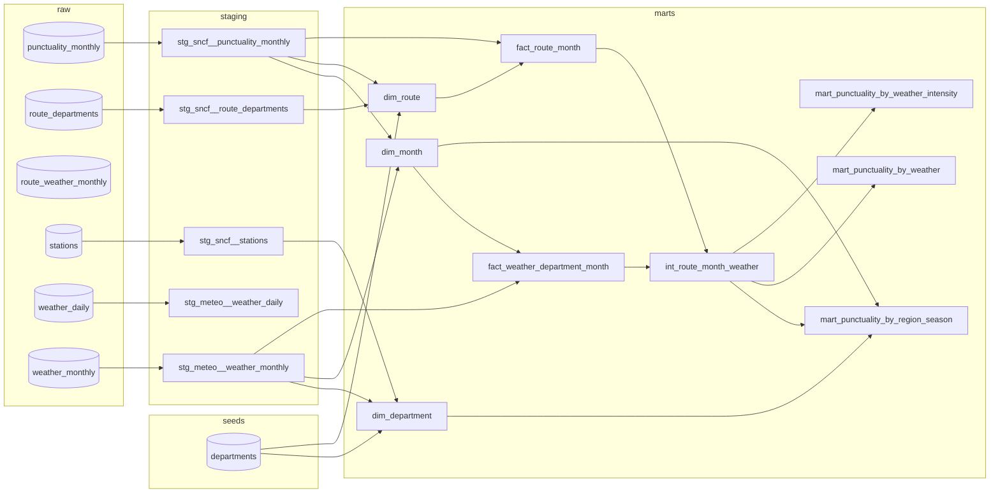

# Railfall

**Do French train delays follow the weather?** A data platform that tracks how rain, wind and frost hit SNCF punctuality.

> 🚧 Work in progress — day 16 of 20 done, see [ROADMAP.md](ROADMAP.md).

## Architecture (target)

```
 SNCF open data ─┐                                   ┌─► dbt (staging → star schema → marts)
                 ├─► Python ingestion ─► MinIO lake ─┤                 │
 Météo-France  ──┘     (bronze)        Spark (silver)└─► Postgres ─────┴─► Metabase dashboards
                                                          warehouse
            └──────────── orchestrated by Airflow · quality gates: dbt tests + Great Expectations ───┘
```

| Layer | Tool | Why |
|---|---|---|
| Ingestion | Python (`httpx`, retries) | Simple, testable, API-agnostic |
| Data lake | MinIO (S3-compatible) | Free locally, same API as AWS S3 |
| Processing | PySpark | Scales to the full historical dataset |
| Warehouse | PostgreSQL | Standard SQL, easy to run anywhere |
| Modeling | dbt | Versioned, tested SQL transformations |
| Orchestration | Airflow | Industry standard scheduler |
| Data quality | dbt tests, Great Expectations | dbt guards the models it builds, GX the raw load underneath |
| Monitoring | SQL over the load audit log, optional local LLM (Ollama) | Freshness and run metrics need no extra service; the LLM only rewords, off by default |
| BI | Metabase (open source) | Free, self-hosted; dashboards provisioned from JSON + SQL through its REST API |
| Infra | Docker Compose, Terraform | Reproducible, infrastructure as code |
| CI | GitHub Actions | Lint + tests on every push |

## Quickstart

```bash
python -m venv .venv && source .venv/bin/activate
pip install -e ".[dev]"
pre-commit install
pytest
```

### Local platform (Postgres + MinIO)

Needs Docker with Compose v2 and Terraform ≥ 1.6; the silver job also needs
Java 17+ and `pip install -e ".[spark]"`, the dbt targets `pip install -e ".[dbt]"`. The first `make up` builds
MinIO from pinned source (no public images exist any more), which takes a few
minutes.

```bash
make up       # build, start Postgres + MinIO, wait until healthy, terraform apply
make health   # check every service answers
make access   # prove each pipeline identity can do its job and nothing more
make infra-check  # fail if the running stack drifted from the Terraform config
make smoke    # also write to the lake and warehouse and read back
make ingest-sncf  # download SNCF punctuality + stations into bronze (idempotent per day)
make verify-sncf  # re-check today's bronze objects against their manifests and contract
make ingest-meteo # download Météo-France daily files for METEO_DEPARTMENTS into bronze
make verify-meteo # re-check today's Météo-France bronze against manifests and contract
make silver       # Spark: clean, type and de-duplicate bronze into silver Parquet
make verify-silver # read silver back: schema contract, unique non-null keys, not empty
make load         # merge silver into the warehouse raw schema (LOAD_ARGS="--year 2025" for one year)
make verify-load  # check raw against silver: columns, primary key, no duplicates, row counts
make dbt-debug    # dbt reaches the warehouse as the transformer role
make dbt-freshness # dbt source freshness on raw (warn > 7 days, error > 40)
make dbt-build DBT_ARGS="--select staging"  # build the staging views and run their tests
make verify-staging # staging views vs raw: row counts, unique non-null grain
make dbt-build DBT_ARGS="--select departments marts"  # seed + star schema and its tests
make verify-marts   # marts: tables, unique grain, facts keep every row, trains reconcile
make weather-report # the weather-impact marts as Markdown, read as railfall_reader
make weather-stats  # significance tests: does bad weather lower punctuality? (by season, dose-response)
make freshness     # every raw table: last successful load (36 h SLA) and newest period vs its source lag
make run-metrics   # recent load runs from the audit log, failed tables, staged-volume anomalies
make monitor       # both, then one anomaly digest (LLM_SUMMARY_ENABLED=1 for local-LLM wording)
make dbt-docs       # dbt docs generate: manifest + catalog introspected from Postgres
make dbt-docs-bundle DOCS_ARGS=--strict  # lineage, doc coverage, schema drift, catalog.md
make readme-catalog # regenerate the data catalog below from `dbt parse` (no database)
make airflow  # build the Airflow image, migrate its metadata DB, start webserver + scheduler
make dag-run DAG=railfall_pipeline  # trigger a DAG over the REST API and wait for it
make metabase     # start Metabase on its Terraform-managed database, wait until healthy
make dashboards   # bootstrap Metabase and provision bi/dashboards (idempotent)
make dashboards-check DASHBOARDS_ARGS="--manifest dbt/target/manifest.json"  # offline spec check
make down     # stop (keeps data); `make clean` also deletes the volumes
```

| Service | URL | Default credentials (`.env`) |
|---|---|---|
| Postgres warehouse | `localhost:5432/warehouse` | `rail` / `rail` |
| MinIO S3 API | http://localhost:9000 | `railfall` / `railfall-secret` |
| MinIO console | http://localhost:9001 | same as above |
| Airflow UI / REST API (`make airflow`) | http://localhost:8080 | `admin` / `admin` |
| Metabase (`make metabase`) | http://localhost:3000 | `admin@railfall.local` / `railfall-metabase1` |

Those are the admin accounts, used only by Terraform. Terraform
(`infra/terraform`) provisions what the pipelines actually connect with:

| Resource | Provisioned by Terraform |
|---|---|
| Lake bucket `railfall-lake` | `bronze/`, `silver/` prefixes; user `railfall-pipeline` limited to this bucket |
| Warehouse schemas | `raw` (owner `railfall_loader`), `staging` + `marts` (owner `railfall_transformer`) |
| Read access | transformer reads `raw`; `railfall_reader` (dashboards) reads `marts` only |

### Bronze layout

```
s3://railfall-lake/bronze/sncf/<dataset>/ingest_date=YYYY-MM-DD/<dataset>.json
s3://railfall-lake/bronze/sncf/<dataset>/ingest_date=YYYY-MM-DD/_manifest.json
```

Raw exports are stored byte-for-byte after a schema check; the manifest records
row count, SHA-256 and source URL. Datasets: `punctuality`
(`regularite-mensuelle-tgv-aqst`) and `stations` (`gares-de-voyageurs`).

```
s3://railfall-lake/bronze/meteo/daily_<dept>_<period>/ingest_date=YYYY-MM-DD/daily_<dept>_<period>.csv.gz
s3://railfall-lake/bronze/meteo/daily_<dept>_<period>/ingest_date=YYYY-MM-DD/_manifest.json
```

Météo-France BASE/QUOT `RR-T-Vent` files (rain, temperature, wind), one per
department, resolved from the data.gouv.fr catalogue and kept as the original
`csv.gz`. `METEO_DEPARTMENTS` (default `75,69,13`) picks the departments;
`python -m railfall.ingest.run meteo --department 33 --period previous` fetches
the long history for a backfill.

### Silver layout

```
s3://railfall-lake/silver/punctuality_monthly/year=YYYY/part-*.parquet
s3://railfall-lake/silver/weather_daily/department=DD/year=YYYY/part-*.parquet
s3://railfall-lake/silver/stations/part-*.parquet
s3://railfall-lake/silver/weather_monthly/year=YYYY/part-*.parquet
s3://railfall-lake/silver/route_departments/part-*.parquet
s3://railfall-lake/silver/route_weather_monthly/year=YYYY/part-*.parquet
s3://railfall-lake/silver/_rejected/<table>/run_date=YYYY-MM-DD/part-*.parquet
```

| Table | Key | Content |
|---|---|---|
| `punctuality_monthly` | month, service, departure, arrival | typed counts, `route_id`, `trains_run`, arrival punctuality rate |
| `weather_daily` | station_id, day | rain, min/max/mean temperature, wind; doubtful or impossible values nulled |
| `stations` | uic_code | name, accent-free `name_key`, department, coordinates |
| `weather_monthly` | department, month | rain total, rain / heavy-rain / frost / strong-wind days, mean temperature and wind, stations per measure |
| `route_departments` | route_id | department of each endpoint and how it was resolved (`alias`, `foreign`, `exact`, `prefix`, `unmatched`) |
| `route_weather_monthly` | month, service, route_id | punctuality joined with weather at both ends (`dep_*`, `arr_*`, `route_*`), `weather_endpoints` 0–2 |

SNCF tables are rebuilt from the newest bronze snapshot; weather reads every
bronze day and keeps the newest row per station-day. Writes overwrite
partitions, so re-running never appends. Rows with an untrustworthy key go to
`_rejected/` with a `reject_reason` instead of being dropped silently.

The three derived tables are built in the same job from silver itself, after
their inputs. `route_weather_monthly` keeps exactly the rows of
`punctuality_monthly` (left joins on unique keys); routes without weather keep
null measures and `weather_endpoints = 0` rather than disappearing.
`verify-silver` reports how many route-months got weather on 0, 1 or 2 ends.

### Warehouse `raw` layout

Every silver table is loaded into `raw.<table>` by `railfall_loader`, with the
same columns (DDL derived from the Parquet schema) and the silver business key
as primary key, plus `_loaded_at` / `_updated_at`.

Each table is merged in its own transaction: `COPY` into a temporary stage,
`INSERT ... ON CONFLICT DO UPDATE` only where a value changed, then delete the
rows of the replaced scope that silver no longer has. Re-running a load
therefore changes nothing. `--year 2025` replaces only that year's partitions;
the small reference tables (`stations`, `route_departments`) always load in full.

Every run appends one row per table to `raw._load_runs` (run id, scope,
staged / inserted / updated / unchanged / deleted rows, outcome, timings), so
"what did the last load do?" has an answer even when it changed nothing.

### Orchestration (Airflow)

Airflow 2.10 (LocalExecutor) runs behind the `airflow` compose profile, so
`make up` stays light; `make airflow` starts it once Terraform has created its
metadata database (`airflow`, its own role, no access to the warehouse). The
image is the official one plus this package and a Java 17 runtime, so tasks run
the same code as the `make` targets, Spark included (local mode in the worker).

| DAG | Schedule | Tasks |
|---|---|---|
| `railfall_ingest` | daily 05:15 UTC | `ingest_sncf → verify_sncf`; `ingest_meteo[dept]` (mapped over `METEO_DEPARTMENTS`) `→ verify_meteo` |
| `railfall_pipeline` | daily 05:15 UTC | the ingestion above, then (once both bronze checks pass) `build_silver → verify_silver → load_warehouse → verify_warehouse → check_raw_quality → monitor_warehouse` |

Each task returns a JSON summary per dataset as its XCom and fails only after
trying every dataset; retries are safe because bronze landing is idempotent.
To force a partition and keep the run report with each task's result:

```bash
make dag-run DAG=railfall_ingest \
  DAG_ARGS="--conf '{\"ingest_date\": \"2026-11-12\"}' --xcom --report run.json"
```

`railfall_pipeline` is the end-to-end DAG: open data → bronze → silver → `raw.*`.
Its Spark tasks get a 60-minute timeout; every step is idempotent, so a retry or
a re-triggered day converges on the same lake and warehouse. Set
`AIRFLOW_USE_JOB_SCHEDULE=false` to run only what you trigger by hand (e2e does).

### Transformations (dbt)

The dbt project lives in `dbt/` and runs on `dbt-postgres` as the
least-privilege `railfall_transformer` role: it reads `raw` and owns `staging`
and `marts`, with schemas created by Terraform, never by dbt. The
`make dbt-*` targets drive dbt in-process (`railfall.transform.dbt`) and print a
per-node report; `--report out.json` keeps it.

| Model | Grain | From |
|---|---|---|
| `staging.stg_sncf__punctuality_monthly` | route × month × service (`route_month_id`) | `raw.punctuality_monthly` |
| `staging.stg_meteo__weather_daily` | station × day | `raw.weather_daily` |
| `staging.stg_sncf__stations` | UIC code | `raw.stations` |

Staging models are views: typed, renamed, an explicit column list and derived
rates (e.g. `cancellation_rate`), never a filter or a join, so each view holds
exactly as many rows as its raw table. Sources declare the silver contract with
`not_null` / unique-grain tests and a freshness check on `_updated_at`; models
add value ranges (the same physical bounds Spark enforces), accepted values and
a cross-column consistency test. AQST cause shares are only range-checked as a
`warn`, because the published percentages are rounded and drift. `make
verify-staging` re-checks the views against raw from outside dbt.

#### Star schema (`marts`)

| Model | Grain | Notes |
|---|---|---|
| `dim_department` | department | `departments` seed (code, name, region) + station and weather coverage |
| `dim_month` | month | gap-free calendar, meteorological season (DJF winter kept in one `season_year`) |
| `dim_route` | route (departure × arrival) | endpoint departments/regions; unmatched endpoints kept with a null department |
| `fact_route_month` | route × service × month | additive AQST counts + total delay minutes; FKs to every dim |
| `fact_weather_department_month` | department × month | monthly weather + anomalies vs the department's own climatology |

Marts are tables. Facts keep counts additive so marts recompute rates at any
grain instead of averaging averages. Singular tests assert each fact keeps every
staging row through its dimension joins, and `make verify-marts` re-checks this
from outside dbt. Selected `build`/`test` runs use `--indirect-selection
buildable`, so `--select staging` never runs a marts test before the facts exist.

#### Weather-impact marts (`marts`)

| Model | Grain | Answers |
|---|---|---|
| `int_route_month_weather` | route × service × month | the weather at both ends, combined into the worse end; one `weather_condition` (frost > wind > rain > calm, `unknown`) |
| `mart_punctuality_by_weather` | factor (rain / wind / frost) × exposure (adverse / normal) | how much worse are wet, windy or frosty months? (`punctuality_gap_pts`) |
| `mart_punctuality_by_region_season` | region × season × factor × exposure | where and when does each factor hurt? (`has_comparison` marks readable gaps) |
| `mart_punctuality_by_weather_intensity` | factor × intensity band | does it get worse the harder it rains / freezes / blows? (gap vs a baseline band) |

Rates are always rebuilt from summed train counts through the
`punctuality_rates()` macro, never averaged. Route-months without weather at
either end stay in `int_route_month_weather` but are left out of the
comparisons. `make weather-report` reads the three marts as `railfall_reader`
(the dashboards' role) and prints headlines, the dose-response table and the
worst region × season cells; e2e appends it to the job summary.

#### Statistical analysis (`railfall.analysis`)

The marts show gaps; `make weather-stats` says whether they are real. It reads
the route-month panel from `int_route_month_weather` as `railfall_reader` and,
per factor (rain, wind, frost):

| Check | Method | Guards against |
|---|---|---|
| Stratified gap | CMH-weighted risk difference inside route × service × season | busy, unpunctual routes that happen to be rainy (Simpson's paradox) |
| p-value | permutation test, adverse flags shuffled within strata | normal-theory assumptions on shares |
| Confidence interval | bootstrap resampling whole routes | route-months of one route not being independent |
| Multiple testing | Benjamini-Hochberg across the 3 factors (and across season cells) | one "significant" factor out of many by chance |
| By season | the same test inside each season | a winter-only frost effect diluted by summer |
| Dose-response | within-stratum slope on rain ratio / strong-wind days / frost days | a binary gap driven by something other than the weather |

Each factor gets a plain-words verdict (*lowers punctuality*, *raises
punctuality*, *no significant effect*, *not testable*) and the slope is read
against it (*supported*, *unsupported*, *contradicted*). The output is Markdown
plus a JSON report; e2e runs it on the real marts, checks every factor was
testable, and appends the result to the job summary. Seeded, so reruns agree.

### Data quality

Two gates, one per layer, so each check runs where the data it guards is built:

| Gate | Guards | Runs | Catches |
|---|---|---|---|
| Great Expectations checkpoint `railfall_raw` | `raw.*` (the Spark load) | `check_raw_quality`, last task of `railfall_pipeline`; `make quality` | value ranges, INSEE / UIC code formats, counters that must reconcile (`trains_run ≤ trains_planned`, `heavy_rain_days ≤ rain_days`), unique keys, empty tables |
| dbt tests | `staging` and `marts` | `make dbt-build` | grain uniqueness, FKs, accepted values / ranges, row preservation through joins, non-empty models (`row_count_in_range`), cross-column invariants (`expression_is_true`), gap-free `dim_month` |

The suites are plain data in `railfall.quality.suites`, versioned with the code;
the checkpoint builds an ephemeral GX context at each run (no `gx/` directory)
and connects as the read-only transformer role, so a gate can never alter what
it inspects. Bounds are physical, not statistical: a 60 °C day is a bug, a very
wet month is the point of the project.

A gate that only ever passes proves little, so `make quality-canary` copies
each real raw table, plants one known defect in one row (a 99 °C minimum, a
department `XX`, a route mapped twice…), runs the real suite on the copy and
requires it to fail on the targeted expectation; the copies are always dropped.
e2e runs the gate inside the DAG, again from the CLI, then the canary, and
publishes the per-table results to the job summary (`quality.md`).

### Docs, lineage and data catalog

`dbt docs generate` runs in e2e against the warehouse built from the real data.
The `dbt-docs` artifact of every e2e run holds the static dbt docs site
(`static_index.html`, opens from disk), `manifest.json` / `catalog.json`, and
the bundle written by `railfall.transform.docs`: `lineage.mmd` / `lineage.json`
(model-level DAG), `coverage.json`, `drift.json` and `catalog.md` with the
warehouse column types. The lineage is also drawn on the run summary.

The step is strict: every declared relation and column must have a description,
and everything the docs declare must exist in Postgres with the declared columns
(columns that exist but are undeclared, such as `_loaded_at`, are listed, not
fatal). The catalog below is generated from the manifest alone, and a unit test
fails when it no longer matches the dbt project.

#### Data catalog

<!-- catalog:start (generated by `make readme-catalog`, do not edit) -->

21 relations, 160 declared columns, 100.0% described.



| Layer | Relation | Kind | Columns | Description | Built from |
|---|---|---|---|---|---|
| raw | `raw.punctuality_monthly` | source | 12 | SNCF monthly TGV punctuality per route (AQST), one row per route-month. |  |
| raw | `raw.route_departments` | source | 8 | TGV route -> departure / arrival department, with match quality. |  |
| raw | `raw.route_weather_monthly` | source | 3 | Route-month punctuality joined with the weather at both endpoints. |  |
| raw | `raw.stations` | source | 6 | SNCF passenger stations, one row per UIC code. |  |
| raw | `raw.weather_daily` | source | 11 | Météo-France daily climatology per station (BASE/QUOT). |  |
| raw | `raw.weather_monthly` | source | 13 | Weather aggregated to department x month. |  |
| seeds | `staging.departments` | seed | 4 | French departments and their region (INSEE Code officiel géographique, 2024 edition: 13 metropolitan regions + 5 overseas). |  |
| staging | `staging.stg_meteo__weather_daily` | view | 9 | Daily weather per Météo-France station. | `weather_daily` |
| staging | `staging.stg_meteo__weather_monthly` | view | 9 | Weather per department and month (coverage-aware Spark roll-up). | `weather_monthly` |
| staging | `staging.stg_sncf__punctuality_monthly` | view | 9 | TGV punctuality per route-month, typed for the star schema. | `punctuality_monthly` |
| staging | `staging.stg_sncf__route_departments` | view | 4 | TGV route -> endpoint departments, with the match method per side. | `route_departments` |
| staging | `staging.stg_sncf__stations` | view | 2 | SNCF passenger stations, one row per UIC code. | `stations` |
| marts | `marts.dim_department` | table | 4 | French departments with their region and the warehouse's coverage of each. | `stg_meteo__weather_monthly`, `stg_sncf__stations`, `departments` |
| marts | `marts.dim_month` | table | 4 | Gap-free calendar of every month the facts cover, with meteorological seasons. | `stg_meteo__weather_monthly`, `stg_sncf__punctuality_monthly` |
| marts | `marts.dim_route` | table | 7 | TGV routes with the department and region of each endpoint. | `stg_sncf__punctuality_monthly`, `stg_sncf__route_departments`, `departments` |
| marts | `marts.fact_route_month` | table | 7 | One row per TGV route, service and month, with AQST counts and rates. | `dim_route`, `stg_sncf__punctuality_monthly` |
| marts | `marts.fact_weather_department_month` | table | 10 | One row per department and month: Météo-France monthly weather with shares of the month, anomalies against the department's own calendar-month climatology, and the wet / frosty / windy flags the marts group by. | `dim_month`, `stg_meteo__weather_monthly` |
| marts | `marts.int_route_month_weather` | table | 9 | fact_route_month with the weather of both endpoint departments that month, combined into the worse of the two ends, and one `weather_condition` label (frost > wind > rain > calm, `unknown` without weather at either end). | `fact_route_month`, `fact_weather_department_month` |
| marts | `marts.mart_punctuality_by_region_season` | table | 12 | The rain / wind / frost comparison of mart_punctuality_by_weather, cut by region (departure end, arrival as fallback) and meteorological season pooled across years. | `dim_department`, `dim_month`, `int_route_month_weather` |
| marts | `marts.mart_punctuality_by_weather` | table | 7 | Punctuality, cancellations and delay of route-months hit by rain, wind or frost against the route-months that were not, rates rebuilt from counts. | `int_route_month_weather` |
| marts | `marts.mart_punctuality_by_weather_intensity` | table | 10 | Punctuality graded by how hard each factor hit the route-month: rain as a ratio of the monthly normal, frost days, strong-wind days. | `int_route_month_weather` |

<details><summary>Columns of the raw layer</summary>

**`raw.punctuality_monthly`**

| Column | Description |
|---|---|
| `month` | First day of the month. |
| `year` | Calendar year of the row, denormalised for partition-style filtering. |
| `route_id` | Stable hash of the normalised departure and arrival station names. |
| `service` | AQST service: "National" or "International". |
| `departure_station` | Departure station as AQST names it (upper case, e.g. PARIS LYON). |
| `arrival_station` | Arrival station as AQST names it (upper case, e.g. MARSEILLE ST CHARLES). |
| `trains_planned` | Trains scheduled on the route that month. |
| `trains_cancelled` | Scheduled trains that did not run. |
| `trains_late_arrival` | Trains that reached the arrival station late (AQST definition). |
| `trains_run` | Trains that ran: planned minus cancelled. |
| `arrival_punctuality_rate` | Share of trains run that arrived on time (0-1). |
| `pct_cause_external` | Share of late trains attributed to external causes (weather, obstacles, strikes), in percent. |

**`raw.route_departments`**

| Column | Description |
|---|---|
| `route_id` | Stable hash of the normalised departure and arrival station names. |
| `departure_station` | Departure station as AQST names it (upper case, e.g. PARIS LYON). |
| `arrival_station` | Arrival station as AQST names it (upper case, e.g. MARSEILLE ST CHARLES). |
| `departure_department` | Department of the departure station; null when foreign or unmatched. |
| `arrival_department` | Department of the arrival station; null when foreign or unmatched. |
| `departure_match` | How the departure station was placed: alias, foreign, exact, prefix or unmatched. |
| `arrival_match` | How the arrival station was placed: alias, foreign, exact, prefix or unmatched. |
| `is_domestic` | True when both endpoints resolved to a French department. |

**`raw.route_weather_monthly`**

| Column | Description |
|---|---|
| `month` | First day of the month. |
| `service` | AQST service: "National" or "International". |
| `route_id` | Stable hash of the normalised departure and arrival station names. |

**`raw.stations`**

| Column | Description |
|---|---|
| `uic_code` | UIC station code, the SNCF stations' natural key. |
| `station_name` | Station name as SNCF publishes it (e.g. Paris Gare de Lyon). |
| `name_key` | Upper-case, accent- and punctuation-free station name, used for matching. |
| `department` | INSEE department code of the station's commune. |
| `latitude` | Station latitude in decimal degrees (WGS84). |
| `longitude` | Station longitude in decimal degrees (WGS84). |

**`raw.weather_daily`**

| Column | Description |
|---|---|
| `department` | INSEE department code of the station. |
| `station_id` | Météo-France station number (8 digits, NUM_POSTE). |
| `day` | Observation date (AAAAMMJJ in the source files). |
| `year` | Calendar year of the observation. |
| `month` | First day of the observation's month. |
| `latitude` | Latitude in decimal degrees (WGS84). |
| `longitude` | Longitude in decimal degrees (WGS84). |
| `precipitation_mm` | Daily precipitation (RR) in millimetres. |
| `temp_min_c` | Minimum temperature (TN) in °C. |
| `temp_max_c` | Maximum temperature (TX) in °C. |
| `wind_mean_ms` | Mean wind speed at 10 m (FFM) in m/s. |

**`raw.weather_monthly`**

| Column | Description |
|---|---|
| `department` | INSEE department code ("01", "2A", "974"). |
| `month` | First day of the month. |
| `year` | Calendar year of the month. |
| `stations` | Distinct Météo-France stations that reported in the department that month. |
| `precipitation_mm` | Mean monthly precipitation of the covered stations, in millimetres. |
| `rain_days` | Days with at least 1 mm of rain, scaled to the full month. |
| `heavy_rain_days` | Days with at least 10 mm of rain, scaled to the full month. |
| `temp_mean_c` | Mean of the stations' monthly mean temperature, in °C. |
| `temp_min_c` | Mean of the stations' monthly mean TN, in °C. |
| `frost_days` | Days with TN below 0 °C, scaled to the full month. |
| `wind_mean_ms` | Mean of the stations' monthly mean wind, in m/s. |
| `wind_max_ms` | Strongest hourly mean wind (FXY) of any station that month, in m/s. |
| `strong_wind_days` | Days with FXY at or above 10.8 m/s (Beaufort 6), scaled to the month. |

</details>

<details><summary>Columns of the seeds layer</summary>

**`staging.departments`**

| Column | Description |
|---|---|
| `department` | INSEE department code ("01", "2A", "974"). |
| `department_name` | Department name (INSEE COG). |
| `region_code` | INSEE region code. |
| `region_name` | Region name (INSEE COG 2024). |

</details>

<details><summary>Columns of the staging layer</summary>

**`staging.stg_meteo__weather_daily`**

| Column | Description |
|---|---|
| `station_id` | Météo-France station number (8 digits, NUM_POSTE). |
| `day` | Observation date (AAAAMMJJ in the source files). |
| `department` | INSEE department code of the station. |
| `precipitation_mm` | Daily precipitation (RR) in millimetres. |
| `temp_min_c` | Minimum temperature (TN) in °C. |
| `temp_max_c` | Maximum temperature (TX) in °C. |
| `temp_mean_c` | Mean temperature (TM, or (TN + TX) / 2 when TM is missing) in °C. |
| `wind_mean_ms` | Mean wind speed at 10 m (FFM) in m/s. |
| `wind_max_hourly_ms` | Highest hourly mean wind of the day (FXY) in m/s. |

**`staging.stg_meteo__weather_monthly`**

| Column | Description |
|---|---|
| `department_month_id` | Surrogate key md5(department \| month). |
| `department` | INSEE department code ("01", "2A", "974"). |
| `month` | First day of the month. |
| `stations` | Distinct stations that reported in the department that month. |
| `rain_days` | Days with at least 1 mm of rain, scaled to the full month. |
| `heavy_rain_days` | Days with at least 10 mm of rain, scaled to the full month. |
| `frost_days` | Days with TN below 0 °C, scaled to the full month. |
| `strong_wind_days` | Days with FXY at or above 10.8 m/s (Beaufort 6), scaled to the month. |
| `precipitation_mm` | Mean monthly precipitation of the covered stations, in millimetres. |

**`staging.stg_sncf__punctuality_monthly`**

| Column | Description |
|---|---|
| `route_month_id` | Surrogate key md5(month \| service \| route_id). |
| `month` | First day of the month. |
| `route_id` | Stable hash of the normalised departure and arrival station names. |
| `service` | AQST service: "National" or "International". |
| `trains_planned` | Trains scheduled on the route that month. |
| `trains_run` | Trains that ran: planned minus cancelled. |
| `arrival_punctuality_rate` | Share of trains run arriving on time (0-1); null when no train ran. |
| `cancellation_rate` | Cancelled / planned trains (0-1); null when nothing was planned. |
| `pct_cause_external` | Share of late trains attributed to external causes, in percent (0-100). The six cause shares come straight from AQST and are only range-checked, as a warning: the published shares are rounded and occasionally drift. |

**`staging.stg_sncf__route_departments`**

| Column | Description |
|---|---|
| `route_id` | Stable hash of the normalised departure and arrival station names. |
| `departure_match` | How the departure station was placed: alias, foreign, exact, prefix or unmatched. |
| `arrival_match` | How the arrival station was placed: alias, foreign, exact, prefix or unmatched. |
| `is_domestic` | True when both endpoints resolved to a French department. |

**`staging.stg_sncf__stations`**

| Column | Description |
|---|---|
| `uic_code` | UIC station code, the SNCF stations' natural key. |
| `department` | INSEE department code of the station's commune. |

</details>

<details><summary>Columns of the marts layer</summary>

**`marts.dim_department`**

| Column | Description |
|---|---|
| `department` | INSEE department code ("01", "2A", "974"). |
| `region_name` | Region the department belongs to (INSEE COG 2024). |
| `stations` | SNCF passenger stations located in the department. |
| `has_weather` | True when Météo-France data exists for the department in the warehouse. |

**`marts.dim_month`**

| Column | Description |
|---|---|
| `month` | First day of the month (the join key of every fact). |
| `month_of_year` | Calendar month number, 1-12. |
| `days_in_month` | Number of days in the month (28-31). |
| `season` | Meteorological season: winter is Dec-Feb, spring Mar-May, summer Jun-Aug, autumn Sep-Nov. |

**`marts.dim_route`**

| Column | Description |
|---|---|
| `route_id` | Stable hash of the normalised departure and arrival station names. |
| `route_label` | Human-readable route, departure → arrival. |
| `departure_department` | Null for foreign or unmatched endpoints. |
| `arrival_department` | Department of the arrival station; null when foreign or unmatched. |
| `departure_match` | How the departure station was placed: alias, foreign, exact, prefix or unmatched. |
| `arrival_match` | How the arrival station was placed: alias, foreign, exact, prefix or unmatched. |
| `months_reported` | Distinct months with at least one punctuality row for the route. |

**`marts.fact_route_month`**

| Column | Description |
|---|---|
| `route_month_id` | Surrogate key md5(month \| service \| route_id). |
| `route_id` | Stable hash of the normalised departure and arrival station names. |
| `month` | First day of the month (joins dim_month). |
| `departure_department` | Department of the departure station; null when foreign or unmatched. |
| `arrival_department` | Department of the arrival station; null when foreign or unmatched. |
| `trains_on_time` | Trains run minus trains late at arrival; null when no train ran. |
| `arrival_punctuality_rate` | Share of trains run that arrived on time (0-1). |

**`marts.fact_weather_department_month`**

| Column | Description |
|---|---|
| `department_month_id` | Surrogate key md5(department \| month). |
| `department` | INSEE department code (joins dim_department). |
| `month` | First day of the month (joins dim_month). |
| `rain_day_share` | rain_days over the length of the month (0-1). |
| `frost_day_share` | frost_days over the length of the month (0-1). |
| `strong_wind_day_share` | strong_wind_days over the length of the month (0-1). |
| `precipitation_ratio` | Month's rain over the department's mean for that calendar month. |
| `is_wet_month` | Rain at least 1.5x the department's normal for that calendar month (needs two years of history). |
| `is_frosty_month` | At least 10 frost days in the month. |
| `is_windy_month` | At least 5 strong-wind days in the month. |

**`marts.int_route_month_weather`**

| Column | Description |
|---|---|
| `route_month_id` | Surrogate key inherited from fact_route_month. |
| `route_id` | Stable hash of the normalised departure and arrival station names. |
| `month` | First day of the month. |
| `is_wet` | Either endpoint department had a wet month. |
| `is_frosty` | Either endpoint department had a frosty month. |
| `is_windy` | Either endpoint department had a windy month. |
| `max_precipitation_ratio` | Higher precipitation_ratio of the two endpoint departments. |
| `weather_coverage` | Which endpoints have weather: both, departure_only, arrival_only or none. |
| `weather_condition` | Single label, worst first: frost > wind > rain > calm; unknown without weather at either end. |

**`marts.mart_punctuality_by_region_season`**

| Column | Description |
|---|---|
| `region_season_exposure_id` | Readable key region_code-season-weather_factor-exposure. |
| `region_code` | INSEE region code of the route (departure end, arrival as fallback). |
| `region_name` | Region name for region_code. |
| `season` | Meteorological season: winter is Dec-Feb, spring Mar-May, summer Jun-Aug, autumn Sep-Nov. |
| `weather_factor` | Weather factor compared: rain, wind or frost. |
| `exposure` | adverse when the route-month was flagged for the factor, otherwise normal. |
| `route_months` | Route-months pooled into the row. |
| `years` | Distinct season-years pooled into the cell (December counts with the next winter). |
| `has_comparison` | True when the region-season-factor has both an adverse and a normal row. |
| `arrival_punctuality_rate` | On-time share of the pooled trains run, rebuilt from the summed counts (0-1). |
| `cancellation_rate` | Cancelled over planned trains, rebuilt from the summed counts (0-1). |
| `punctuality_gap_pts` | Adverse minus normal arrival punctuality, in percentage points. |

**`marts.mart_punctuality_by_weather`**

| Column | Description |
|---|---|
| `weather_exposure_id` | Readable key weather_factor-exposure (e.g. rain-adverse). |
| `weather_factor` | Weather factor compared: rain, wind or frost. |
| `exposure` | adverse when the route-month was flagged for the factor, otherwise normal. |
| `route_months` | Route-months pooled into the row. |
| `arrival_punctuality_rate` | On-time share of the pooled trains run, rebuilt from the summed counts (0-1). |
| `cancellation_rate` | Cancelled over planned trains, rebuilt from the summed counts (0-1). |
| `punctuality_gap_pts` | Adverse minus normal arrival punctuality, in percentage points. |

**`marts.mart_punctuality_by_weather_intensity`**

| Column | Description |
|---|---|
| `weather_intensity_id` | Readable key weather_factor-intensity_band (e.g. frost-hard). |
| `weather_factor` | Weather factor compared: rain, wind or frost. |
| `intensity_band` | Named intensity band of the factor (e.g. rain: dry … extreme; frost: none … severe). |
| `band_order` | 1 is the mildest band of the factor; sort by it to read a dose-response. |
| `is_baseline` | True for the factor's reference band the gap columns compare against. |
| `route_months` | Route-months whose worse end falls in the band. |
| `min_intensity` | Lowest intensity value observed in the band (ratio for rain, days otherwise). |
| `arrival_punctuality_rate` | On-time share of the pooled trains run, rebuilt from the summed counts (0-1). |
| `cancellation_rate` | Cancelled over planned trains, rebuilt from the summed counts (0-1). |
| `punctuality_gap_pts` | Band minus baseline arrival punctuality, in percentage points. |

</details>

<!-- catalog:end -->

### Monitoring

Two questions are asked of every `raw.*` table after each load, from the load
audit log (`raw._load_runs`) rather than row timestamps, because an idempotent
merge that changed nothing leaves those untouched:

| Check | Source | Flags |
|---|---|---|
| Load freshness | last successful load per table | older than 36 h (one late or retried daily run tolerated) |
| Data freshness | newest `month` / `day` | behind the source's publication lag (SNCF 125 days, Météo daily 45, monthly 70) |
| Run metrics | latest run per table | a failed table; rows staged < 0.5× or > 2× the median of ≥ 3 earlier loads of the same scope |

`make monitor` writes `freshness.json`, `runs.json` and `summary.json` to
`monitoring-reports/` and prints one digest, most severe anomaly first. In
Airflow the same checks run as `monitor_warehouse`, the last task of
`railfall_pipeline`: a failed, missing or empty table turns the run red, while a
lagging publisher or an odd volume is only reported, since a retry cannot fix
either.

The plain-language summary is opt-in: with `LLM_SUMMARY_ENABLED=1` (and
`LLM_URL` / `LLM_MODEL` pointing at a local [Ollama](https://ollama.com)), only
the anomaly facts are sent to the model, never table contents, and only when
something is wrong. If the model is unreachable, slow or rambles, the rule-based
digest is used instead. e2e runs the monitor on the real warehouse, checks it
agrees with the DAG task, and points the LLM at a closed port to prove that
fallback.

### Dashboards (Metabase)

Metabase runs in the `bi` Compose profile and keeps its own state in a
`metabase` Postgres database that Terraform creates, so dashboards survive a
`make down`. Nothing is clicked: `make dashboards` creates the admin with the
one-time setup token (or logs in), registers the warehouse as
`railfall_reader` restricted to `marts`, waits for the sync, then provisions
every spec under `bi/dashboards/`:

```
bi/dashboards/weather_impact/
  dashboard.json          name, collection, cards, 24-column grid layout
  overall_punctuality.sql one read-only native query per card, on marts.* only
  ...
```

Specs are validated before Metabase is called (single read-only statement,
declared tables match the SQL, no overlapping cards). Questions are matched by
name and updated in place, cards a spec no longer claims are archived, and
every card is then run: a failed or empty card fails the command. The spec is
the source of truth, so UI edits to provisioned items are overwritten.
`make dashboards-check` validates the specs offline and, with a dbt manifest,
that every table they read is a mart dbt still builds. In e2e all of this runs
twice on the real marts and must leave the same card and dashcard ids.

## How this project is built

This project is built with an AI pair-programmer (Claude) in a deliberate,
reviewable workflow — see [docs/AI_WORKFLOW.md](docs/AI_WORKFLOW.md).
Every design choice is logged in [docs/DECISIONS.md](docs/DECISIONS.md).

## Project layout

```
src/railfall/       Python package (config, ingestion, Spark silver jobs, warehouse load, dbt runner)
dbt/                dbt project: raw sources, staging, star schema (marts), seeds, tests
dags/               Airflow DAGs (thin wiring over railfall.orchestration)
bi/dashboards/      Metabase dashboards as code: one JSON spec + SQL files per dashboard
tests/              Unit tests (pytest)
infra/terraform/    Terraform: lake bucket, IAM, warehouse schemas and roles
infra/minio/        Source build of the pinned MinIO image
infra/airflow/      Airflow image: official image + the railfall package
docs/               Architecture decisions and workflow
```
