# Architecture

Railfall is a small batch platform that runs entirely on one machine with
`make up`. Two open-data sources land in a MinIO lake, Spark cleans and joins
them, a merge loads the result into Postgres, dbt models it into a star schema
and weather-impact marts, and Metabase plus a statistical report read the
marts. Airflow runs the whole chain daily; Terraform provisions the bucket,
schemas and roles the services use.

The diagram below is checked by `tests/test_architecture.py`: every Docker
Compose service, every task of the `railfall_pipeline` DAG and every warehouse
schema must appear in it, so it cannot silently drift from the code.

```mermaid
flowchart LR
  %% ---- sources -------------------------------------------------------
  subgraph sources["Open data (HTTPS)"]
    sncf[["SNCF open data<br/>punctuality + stations"]]
    meteo[["Météo-France<br/>daily climatology per department"]]
  end

  %% ---- Airflow: railfall_pipeline DAG --------------------------------
  subgraph airflow["Airflow (airflow-webserver, airflow-scheduler, airflow-init)"]
    direction LR
    ingest_sncf --> verify_sncf
    ingest_meteo["ingest_meteo[dept]"] --> verify_meteo
    verify_sncf --> build_silver
    verify_meteo --> build_silver
    build_silver --> verify_silver --> load_warehouse --> verify_warehouse
    verify_warehouse --> check_raw_quality --> monitor_warehouse
  end

  %% ---- lake ----------------------------------------------------------
  subgraph minio["MinIO lake (minio) · bucket provisioned by Terraform"]
    bronze[("bronze/<br/>raw JSON + CSV,<br/>partitioned by ingest_date")]
    silver[("silver/<br/>typed Parquet")]
  end

  %% ---- warehouse -----------------------------------------------------
  subgraph postgres["Postgres warehouse (postgres)"]
    raw[("raw<br/>merged on natural keys,<br/>_load_runs audit log")]
    staging[("staging<br/>dbt views")]
    marts[("marts<br/>star schema +<br/>weather-impact marts")]
  end

  %% ---- consumers -----------------------------------------------------
  metabase["Metabase (metabase)<br/>dashboards as code"]
  analysis["railfall.analysis<br/>weather-stats, charts"]
  gx{{"Great Expectations<br/>checkpoint on raw"}}
  dbt{{"dbt build<br/>models + tests"}}

  sncf --> ingest_sncf
  meteo --> ingest_meteo
  ingest_sncf -. writes .-> bronze
  ingest_meteo -. writes .-> bronze
  build_silver -. "PySpark over S3A" .-> silver
  bronze -. reads .-> build_silver
  load_warehouse -. "upsert ON CONFLICT" .-> raw
  silver -. reads .-> load_warehouse
  check_raw_quality -. runs .-> gx
  gx -. validates .-> raw
  raw --> dbt --> staging --> marts
  marts --> metabase
  marts --> analysis
  monitor_warehouse -. "freshness + run metrics" .-> raw

  classDef store fill:#eef4ff,stroke:#3b6bc9
  classDef task fill:#fff7e6,stroke:#c98a1b
  class bronze,silver,raw,staging,marts store
  class ingest_sncf,verify_sncf,ingest_meteo,verify_meteo,build_silver,verify_silver,load_warehouse,verify_warehouse,check_raw_quality,monitor_warehouse task
```

## How the pieces fit

| Stage | Runs as | Writes | Idempotency |
|---|---|---|---|
| Ingest | `ingest_sncf`, `ingest_meteo[dept]` (Python, `httpx`) | `bronze/` in MinIO | content hash: a known file is skipped |
| Silver | `build_silver` (PySpark, local session per task) | `silver/` Parquet | partition overwrite |
| Load | `load_warehouse` (psycopg) | `raw.*` + `raw._load_runs` audit | `INSERT ... ON CONFLICT` upsert on natural keys |
| Quality | `check_raw_quality` (GX), `dbt build` tests | GX results, dbt test results | read-only |
| Model | dbt (`make dbt-build`) | `staging.*`, `marts.*` | full rebuild of views/tables |
| Monitor | `monitor_warehouse` | anomaly summary (XCom + log) | read-only |
| Serve | Metabase, `railfall.analysis` | dashboards, `weather-stats.json`, SVG charts | dashboards upserted by name |

## Provisioning

Terraform (`infra/terraform/`) is applied against the running Compose stack:

* **MinIO**: the lake bucket (`var.lake_bucket`), its `bronze/` and `silver/` layer markers, and a
  `pipeline` IAM user restricted to that bucket.
* **Postgres**: the `raw`, `staging` and `marts` schemas; one login role per
  actor (`railfall_loader` writes `raw`, `railfall_transformer` reads `raw` and
  writes `staging`/`marts`, `railfall_reader` reads `marts` for BI); separate databases for Airflow and Metabase metadata.

Every credential comes from environment variables (`.env`, see `.env.example`);
nothing is hard-coded.
